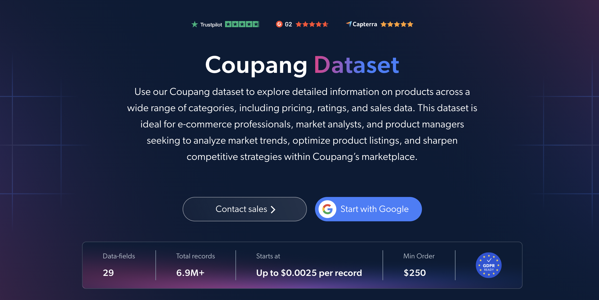

# Coupang 数据集样本
<h2>包含 1,000 件 Coupang 商品的示例数据集</h2>

使用 Bright Data API 提取的 Coupang 商品数据集。

数据点包括：

- `url`
- `id`
- `title`
- `rating`
- `reviews`
- `discount`
- `currency`
- `seller_name`
- `shop_url`
- `seller_rating`
- `seller_reviews`
- `images`
- `main_image`
- `categories`
- `root_category`
- `root_category_url`
- `shipping_company`
- `shipping_details`
- `variations`
- `variant_id`
- `variant`

以及更多内容。

我们的 Coupang 商品（公开数据）数据集包含超过 **6,900,000 条商品记录**，涵盖韩国最大电商平台 Coupang 上的商品标题、评分、评论、折扣、卖家信息、类别层级、配送选项、商品变体和图片。

**文件格式：** JSON、NDJSON、JSON Lines、CSV、XLSX 或 Parquet。可选择压缩为 .gz 格式。

**交付选项：** Snowflake、Amazon S3、Google Cloud、Azure、SFTP 或 Webhook。

**更新频率：** 一次性购买，或每日、每周、每月、每季度或每半年更新。

**数据增强：** 通过应用筛选条件，仅获取你需要的记录和字段，或使用其他数据点丰富数据集。

<a href="https://www.bright.cn/products/datasets/coupang">获取完整的 Coupang 数据集</a>

## 使用场景

### 折扣和促销分析
将 `discount` 字段与 `shipping_details`（免运费、Rocket 配送、有条件免运费）结合使用，了解不同类别和卖家的促销及配送优惠有何差异。

### 卖家和平台分析
按 `seller_rating` 和 `seller_reviews` 比较卖家，并使用 `seller_name` 和 `shop_url` 了解自营商品（如 Coupang Global）与第三方平台卖家的差异。

### 客户情绪和商品表现
使用 `rating` 和 `reviews` 对商品反馈进行基准分析，找出类别中评分最高的商品，并跟踪评论数量与折扣及配送选项之间的关系。

### 类别和商品组合映射
使用完整的 `categories` 路径、`root_category` 和 `variations` 映射 Coupang 的目录结构，比较不同垂直品类的商品组合深度，并分析尺寸、颜色和数量等商品选项。

### 配送和履约洞察
分析 `shipping_company` 和 `shipping_details`，了解哪些承运商（CJ Logistics、Hanjin、Lotte 等）和履约模式（Rocket、Global、卖家发货）在各类别中占据主导地位。

## Bright Initiative

Bright Data 通过 [Bright Initiative](https://brightinitiative.com/) 计划向学术机构和非政府组织免费提供其数据集。
